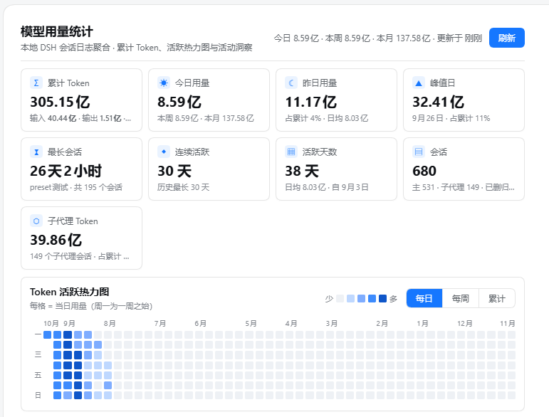
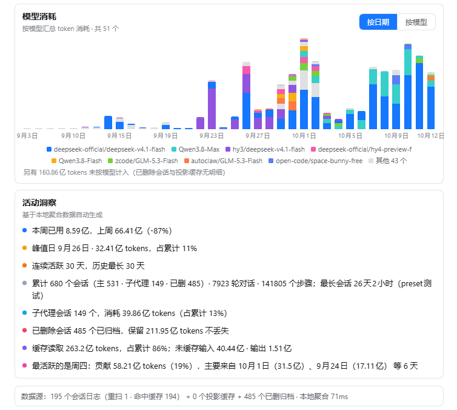
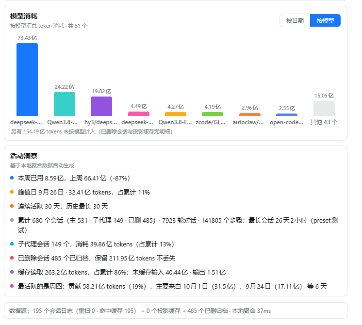

# dsh-usage-heatmap

模型用量统计面板 — 装在 DSH 设置页里的 Token 用量看板：九宫指标卡 + GitHub 风格热力图 + 模型消耗分析 + 活动洞察，数据全部在本地聚合。

An all-local token usage dashboard for the DeepSeek Harness settings page.

## 截图 / Screenshots

| 面板总览（指标卡 + 热力图） | 模型消耗 · 按日期（默认） | 模型消耗 · 按模型 |
| --- | --- | --- |
|  |  |  |

> 图中数据来自作者本机（真实聚合结果），「其他 N 个模型」灰色柱/段为未进 top8 的模型合计；差额行诚实披露已删会话与投影缓存中无模型明细的部分。

## 功能 / Features

- **九宫指标卡**：累计 Token、今日、昨日、峰值日、最长会话、连续活跃（当前 / 历史最长）、活跃天数、会话数（主 / 子代理）、子代理 Token。
- **热力图**：GitHub 风格日历，每格 = 当日用量（周一为一周之始），可切「每日 / 每周 / 累计」三档；行标一/三/五/日与格子按同一 7 行网格对齐；列数随容器宽度自适应。
- **模型消耗分析**：按 `provider/model` 汇总 token 消耗，双版式可切换——「按日期」堆叠多色柱（横轴本地日、柱内段为模型、8 色调色板 + 图例）与「按模型」柱状（数值标签贴柱顶）；悬停任意段/柱/图例显示三行明细，图例联动高亮全部柱中对应模型段。
- **活动洞察**：峰值日占比、连续活跃区间、会话构成、最长会话、子代理占比、缓存读取占比、今日四桶（未缓存输入 / 输出 / 缓存读 / 缓存写）、最活跃星期（附大头日期证据）。
- **不丢数**：会话日志被删后，历史 token 仍从投影缓存（`session_projcache`）与已扫入的归档分桶中保留；面板把「已删归档」与「孤儿投影」分开标注。
- **性能**：会话日志为仅追加的 zstd 帧格式，面板按帧边界**增量续解**——文件变更时只解码折叠尾部新帧，而非整文件重扫；目录成员与投影文件记忆化，仍逐轮检查目录与日志变更；按耗时让出事件循环，持久化快照使重启首帧秒开。可见面板每 15 秒直接获取本次扫描结果，隐藏页暂停轮询，避免旧缓存多等一轮；面板根为自滚动容器（`will-change: scroll-position`），滚动走合成器线程。

## 安装 / Install

从 npm 安装：

```bash
dsh plugin add dsh-usage-heatmap
```

从 GitHub 安装（仓库已提交 `lib/`，无需构建）：

```bash
dsh plugin add github:zeng6125-rgb/dsh-usage-heatmap
```

或使用 Release 里的预构建 tarball：

```bash
dsh plugin add https://github.com/zeng6125-rgb/dsh-usage-heatmap/releases/latest/download/dsh-usage-heatmap.tgz
```

装好后在 **设置 → 模型用量统计** 查看。首次扫描需要几秒（取决于会话日志总量），之后走缓存与快照，秒开。

## 数据来源 / Where the numbers come from

全部为本地文件，插件不发起任何网络请求：

| 来源 | 路径 | 用途 |
| --- | --- | --- |
| 会话日志 | `~/.dsh/sessions/<cwd>/<sessionId>/session.v4.jsonl.zstd` | 逐日分桶（仅追加多帧 zstd，增量续解） |
| 会话投影缓存 | `~/.dsh/storages/session_projcache/sessions/*.json` | 会话级累计 token、会话元信息、孤儿/回填口径对账 |
| 聚合缓存 | `~/.dsh/storages/usage-heatmap/cache.json` | 增量扫描结果、归档与续扫边界 |
| 快照 | `~/.dsh/storages/usage-heatmap/last-state.json` | 重启后首帧秒开 |

> 逐日分桶依赖会话日志中的事件时间戳；缺失时回退到 `createdAt` / 文件 mtime 摊分。
> 增量续解使用前缀头尾各 512KB 与长度的采样 sha256 守卫；采样不符或续扫边界失效时回退全量折叠。正确性依赖 DSH 日志仅追加的契约：长前缀中部改写不在采样检测范围内，不承诺识别任意文件篡改。

## 开发 / Development

```bash
DSH_CHECKOUT=<dsh source checkout> bash scripts/build.sh   # src/ → lib/
npm run typecheck                                          # tsc --noEmit
npm test                                                   # 性能与数据获取回归测试
```

`scripts/build.sh` 需要一份 DSH 源码检出（`DSH_CHECKOUT`，或 `~/dsh-harness` / `~/dsh` / `~/.dsh/dsh-harness` 之一）来链接 `@deepseek-ai/*` 与 `cordis`；终端用户安装时用的是仓库里已提交的 `lib/`，不需要这一步。

## License

BSD-3-Clause
